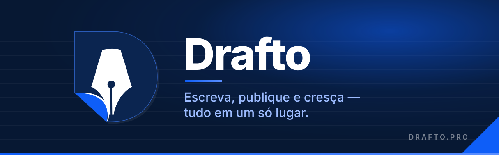
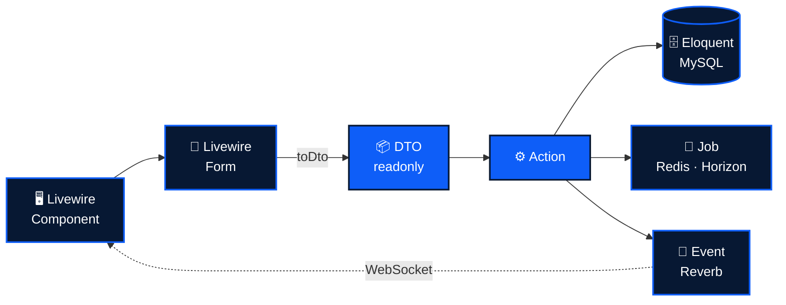

<div align="center">



<br />

**A plataforma de escrita para quem quer publicar bem, ser encontrado e construir audiência.**

<br />

[](https://php.net)
[](https://laravel.com)
[](https://livewire.laravel.com)
[](https://tailwindcss.com)
<br />
[](https://reverb.laravel.com)
[](https://laravel.com/docs/horizon)
[](https://pulse.laravel.com)
[](https://redis.io)
<br />
[](https://pestphp.com)
[](.github/workflows/ci.yml)
[](docs/cloudflare-cache.md)

<br />

[**Novidades**](#-novidades-recentes) ·
[**Recursos**](#-recursos) ·
[**Arquitetura**](#-arquitetura) ·
[**Stack**](#-stack) ·
[**Começando**](#-começando) ·
[**Qualidade**](#-qualidade) ·
[**Produção**](#-produção)

</div>

<br />

## ✦ O que é o Drafto

O **Drafto** é uma plataforma de alta performance para escritores e criadores que querem um ambiente organizado para **criar, publicar e gerir conteúdo**. O projeto foi pensado desde o início para **SEO**, **escalabilidade** e **interação social**, e usa o que há de mais moderno no ecossistema PHP: Laravel 13, Livewire 4, Tailwind 4 e tempo real com Reverb.

<br />

## 🆕 Novidades recentes

| | |
|---|---|
| ⚡ **Tempo real** | Sino de notificações e exports ao vivo via **Laravel Reverb**, sem precisar recarregar a página. → [Observabilidade](#-observabilidade) |
| 🚀 **Redis + Horizon** | Cache, sessão e filas no Redis, com workers gerenciados pelo **Horizon**. → [Stack](#-stack) |
| 📈 **Laravel Pulse** | Painel de saúde com requests, queries e jobs lentos, exceções, servidor e conexões do Reverb. → [Observabilidade](#-observabilidade) |
| 🎨 **Perfil 100% estilizável** | Cores, fundo translúcido e edição em abas com sidebar retrátil. → [Recursos](#-recursos) |
| 🔗 **Compartilhar post** | Modal com QR Code e atalhos para as redes sociais. → [Recursos](#-recursos) |
| 🛡️ **Hardening de segurança** | Auditoria de auth (2FA, magic link, reset, impersonação), correção de bypass de autorização e de IDOR. → [Segurança](#%EF%B8%8F-segurança) |
| 🏎️ **Lighthouse 100** | A11y, SEO e boas práticas em 100, CLS de 0.418 para 0 e mídia otimizada (cerca de 419 KiB a menos). → [Performance](#%EF%B8%8F-performance--seo) |
| 🔄 **Deploy sem atrito** | Build dos assets no deploy, troca de release sem derrubar a sessão e auto-release por tag. → [Produção](#-produção) |

<br />

## 💎 Recursos

<table>
<tr>
<td width="50%" valign="top">

### ✍️ Escrita
- **Editor com rascunhos** e fluxo de publicação
- **Agendamento de posts** (módulo `post_scheduler`)
- **Coleções** e **posts salvos**
- **Compartilhar** com QR Code e redes sociais

</td>
<td width="50%" valign="top">

### 🌐 Alcance & SEO
- **Metadados automáticos** e **Schema.org (JSON-LD)** para posts e perfis
- **Sitemap** e `robots.txt` gerados
- **Encurtador de links** (módulo `link_shortener`)
- **Newsletter** com broadcast para assinantes

</td>
</tr>
<tr>
<td width="50%" valign="top">

### 🤝 Social
- **Likes, follows e comentários**
- **Notificações em tempo real** (Reverb)
- **Perfil público estilizável**: cores, fundo, badge
- Métricas de visualização de post, perfil e site

</td>
<td width="50%" valign="top">

### 🛠️ Administração
- **Módulos por usuário**: feature flags via `ModuleEnum`
- Gestão de usuários, moderadores e **denúncias**
- **Impersonação auditada** (`ImpersonationLog`)
- **Suporte**, e-mails de reengajamento e **exports** ao vivo

</td>
</tr>
</table>

<br />

## 🏗️ Arquitetura

O fluxo é sempre o mesmo. A interface coleta e valida os dados, um **DTO** imutável os transporta, e uma **Action** executa a regra de negócio. O trabalho pesado vai para a fila.



- **Actions** (`app/Actions`): toda regra de negócio fica em classes atômicas e testáveis. Componentes e controllers são finos.
- **DTOs** (`spatie/laravel-data`): dados tipados e imutáveis entre camadas, sem arrays "mágicos".
- **Enums**: estados, papéis e módulos tipados (`RoleEnum`, `ModuleEnum` e outros).
- **Jobs assíncronos**: processamento de mídia, SEO, views, newsletter e exports fora do ciclo da request.

<br />

## 🧰 Stack

| Camada | Tecnologia |
|---|---|
| **Core** | PHP 8.3+ · Laravel 13 · `strict_types` · `readonly` · Enums |
| **Frontend** | Livewire 4 · Alpine.js · Tailwind CSS 4 · Vite · Laravel Echo |
| **Dados** | MySQL 8.4 · Redis (cache, sessão e filas) |
| **Tempo real** | Laravel Reverb (WebSocket) |
| **Filas** | Laravel Horizon |
| **Observabilidade** | Laravel Pulse com cards do Reverb |
| **Infra dev** | Docker · Laravel Sail (app, queue, reverb, mysql, redis, mailpit) |
| **Deploy** | Deployer (`deploy.php`) · GitHub Actions · Cloudflare |

<br />

## 📡 Observabilidade

| Painel | Para que serve | Acesso |
|---|---|---|
| **Horizon** · `/horizon` | Jobs, falhas e retry, throughput por fila, workers | `super_admin` · Admin → *Filas (Horizon)* |
| **Pulse** · `/pulse` | Servidor (CPU/RAM/disco), requests, queries e jobs lentos, cache, exceções, uso por usuário | `super_admin` · Admin → *Monitoramento (Pulse)* |
| **Reverb** | Conexões abertas e mensagens por minuto, exibidas nos cards do Pulse | via Pulse |

> [!NOTE]
> Em produção, o Pulse ingere via Redis (`PULSE_INGEST_DRIVER=redis`) e precisa dos processos `pulse:check` e `pulse:work` no Supervisor. Veja [`docs/reverb-horizon-producao.md`](docs/reverb-horizon-producao.md).

<br />

## 🛡️ Segurança

- Auditoria completa dos fluxos de **autenticação**: 2FA (TOTP), magic link, reset de senha e impersonação
- Correção de **bypass estrutural de autorização** e de **IDOR** em coleções, com Policies em todos os recursos
- Painéis operacionais protegidos por gate (`viewHorizon` e `viewPulse` restritos a `super_admin`)
- Nenhum segredo versionado: `APP_KEY` estática e chaves de teste removidas do `.env.testing`

<br />

## 🏎️ Performance & SEO

- **Lighthouse 100** em acessibilidade, SEO e boas práticas, no desktop e no mobile
- **CLS de 0.418 para 0**: sem lazy em conteúdo acima da dobra, fade no hero e fonte assíncrona
- **LCP** sem atraso de renderização no hero
- **`media:optimize`**: avatares e capas redimensionados, cerca de 419 KiB economizados
- **Cache na borda** com Cloudflare e Brotli. Runbook em [`docs/cloudflare-cache.md`](docs/cloudflare-cache.md)

### 📊 Benchmarks

Medidos em **14/10/2026** no ambiente local (Sail, 8 vCPUs, 17 GB RAM, MySQL 8.4 + Redis), sem worker de fila rodando:

| Cenário | Ferramenta | Resultado |
|---|---|---|
| ❤️ **Likes em sequência** (`ToggleLikeAction`, 500 likes de 100 usuários, 3 rodadas) | `artisan benchmark:scale` | **~105 interações/s** · 0 erros |
| ✍️ **Salvar post complexo** (`SavePostAction`: ~13 KB de HTML, 5 tags, publicação + SEO enfileirado; 50 amostras após aquecimento) | script PHP | **p50 82 ms** · **p95 97 ms** · máx 121 ms |
| 🏠 **Home** `/` | k6 · 35 iterações/min por 2 min | p50 174 ms · p95 208 ms |
| 📚 **Explorar** `/artigos` | k6 | p50 92 ms · p95 109 ms |
| 📄 **Post** `/posts/{slug}` (com rastreio de view) | k6 | p50 196 ms · p95 243 ms |
| ⚠️ **Falhas HTTP** | k6 | **0%** (210 requests) |

> [!NOTE]
> As páginas públicas têm **rate limit de 120 req/min por IP** (`throttle:public-content`). Por isso o k6 mede **latência** abaixo do limite, e não vazão máxima: acima dele, o próprio limiter devolve `429`. Os números de produção (PHP-FPM + OPcache + Cloudflare) tendem a ser melhores que os do ambiente de desenvolvimento.

<br />

## 🚀 Começando

> [!TIP]
> Só precisa de **Docker**. PHP, MySQL, Redis, Reverb e a fila sobem no Sail.

```bash
# 1. Clone
git clone git@github.com:huriellopes/mvp-drafto.git && cd mvp-drafto

# 2. Ambiente
cp .env.example .env            # ajuste WWWUSER/WWWGROUP se necessário

# 3. Dependências PHP (antes do Sail existir)
docker run --rm -u "$(id -u):$(id -g)" -v "$(pwd):/var/www/html" -w /var/www/html \
  laravelsail/php84-composer:latest composer install --ignore-platform-reqs

# 4. Suba os containers (app, queue, reverb, mysql, redis, mailpit)
./vendor/bin/sail up -d

# 5. App
./vendor/bin/sail artisan key:generate
./vendor/bin/sail artisan migrate --seed
./vendor/bin/sail npm install
./vendor/bin/sail npm run dev
```

<br />

## ✅ Qualidade

Cada PR passa por **todos** estes checks no CI ([`ci.yml`](.github/workflows/ci.yml)):

| Check | Comando |
|---|---|
| 🎨 **Pint** (estilo) | `./vendor/bin/sail pint --test` |
| 🔍 **PHPStan / Larastan** | `./vendor/bin/sail php vendor/bin/phpstan analyse` |
| ♻️ **Rector** (dry-run, inclui lint de padrões Livewire) | `./vendor/bin/sail php vendor/bin/rector process --dry-run` |
| 🧪 **Pest** + gate de cobertura | `./vendor/bin/sail artisan test --coverage --min=98` |

Também há **testes de arquitetura** (Pest Arch) garantindo os padrões dos componentes Livewire.

<details>
<summary><b>🤖 Automações do Claude Code no repositório</b></summary>

<br />

| Tipo | Nome | Para quê |
|---|---|---|
| Skill | `drafto-conventions` | Convenções de arquitetura e código |
| Skill | `drafto-domain-map` | Mapa de domínio, módulos e agendamentos |
| Comando | `/new-action` | Scaffold de Action + DTO + teste Pest |
| Comando | `/new-module` | Scaffold de módulo (feature flag por usuário) |
| Comando | `/pre-pr` | Roda localmente os mesmos checks do CI |
| Subagente | `laravel-architect` | Implementa features de ponta a ponta |
| Subagente | `qa-pest` | Escreve e revisa testes, cuida do gate de 98% |
| Subagente | `security-reviewer` | Revisa auth, 2FA, impersonação e Policies |
| Subagente | `db-migration-reviewer` | Revisa migrations: índices, rollback, N+1 |

</details>

<br />

## 📦 Produção

- **Deploy** com Deployer: build dos assets, migrations, troca atômica de release **sem deslogar ninguém**, depois `horizon:terminate`, `reverb:restart`, `pulse:restart` e reload do PHP-FPM
- **Release automático**: cada push na `main` gera uma tag de patch e um GitHub Release. A versão aparece no dashboard
- **Runbooks**:
  - [`docs/reverb-horizon-producao.md`](docs/reverb-horizon-producao.md): Redis, Horizon, Reverb, Pulse e Supervisor
  - [`docs/cloudflare-cache.md`](docs/cloudflare-cache.md): cache na borda, Brotli e `media:optimize`

<br />

---

<div align="center">


**Drafto** · Escreva, publique e cresça.

Feito com 💙 por **Huriel Lopes** · [Licença MIT](LICENSE)

</div>
